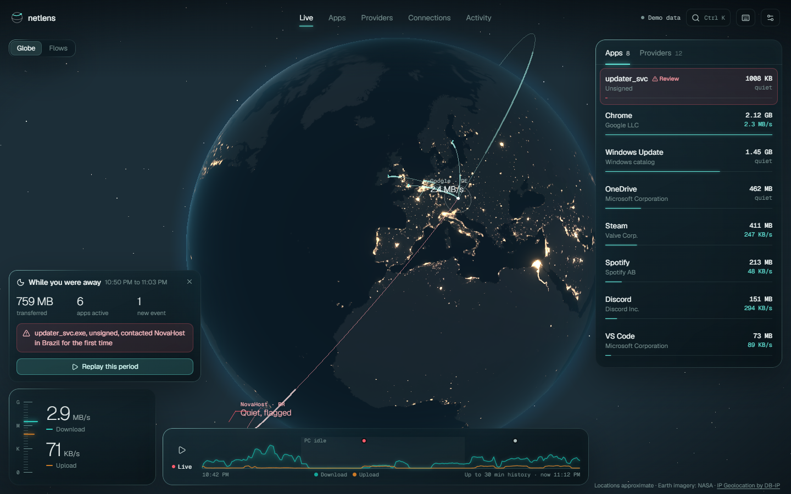
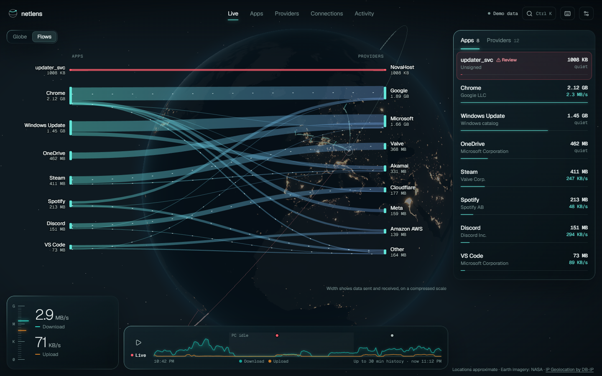
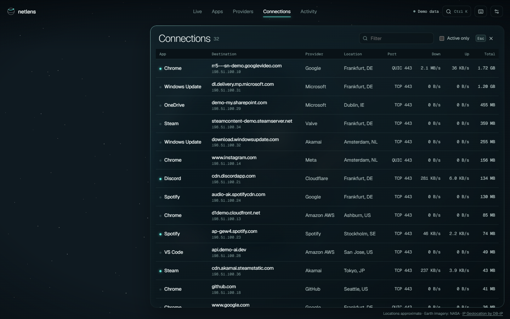
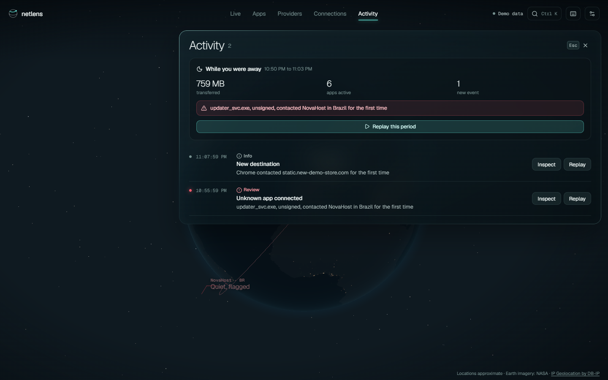
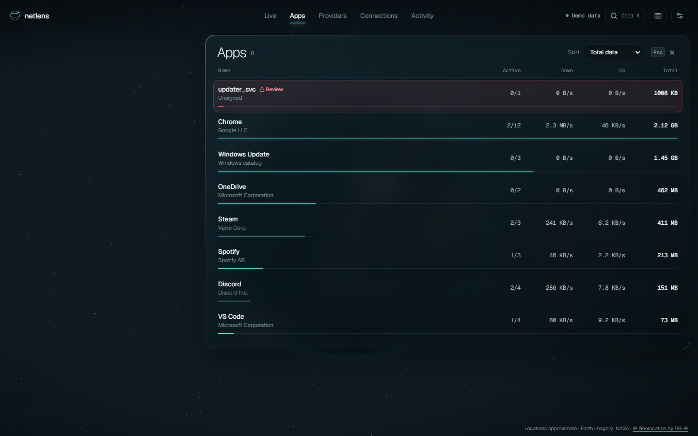
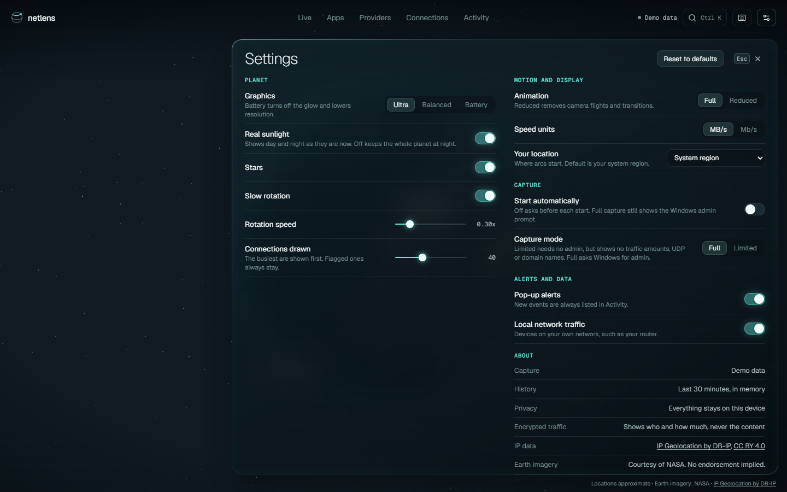
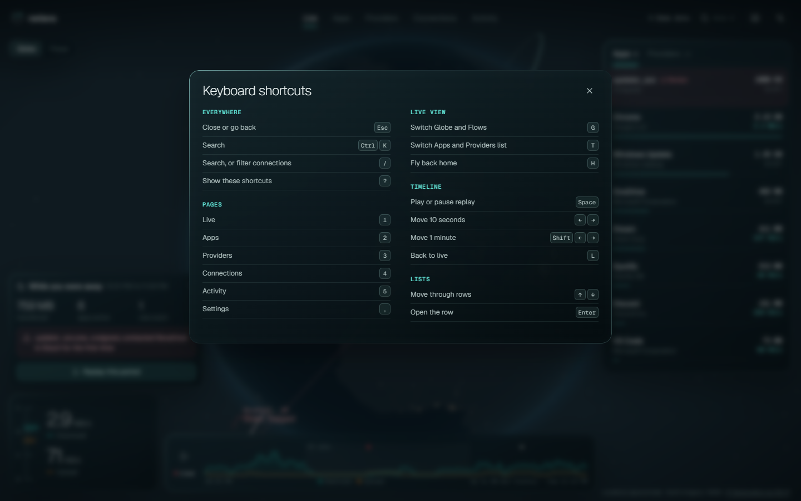

# NetLens

A task manager for network traffic. NetLens shows, live, which apps on your computer talk to which providers and countries, how much data they move, and when something new appears. Windows now, Android later.

It keeps you informed, but it isn't tamper-proof: malware with kernel access can hide from any monitor running on the same machine.



| | |
|---|---|
|  **Flows:** which apps talk to which providers |  **Connections:** every destination, searchable |
|  **Activity:** first-seen alerts and what happened while you were away |  **Apps:** speeds and totals per app |
|  **Settings** |  **Keyboard shortcuts** |

<sub>Screenshots use the built-in demo data. App names are examples, and NovaHost and `updater_svc` are invented to show a flagged app.</sub>

## Contents

- [Requirements](#requirements)
- [Build and run](#build-and-run)
- [Using the app](#using-the-app)
- [Develop](#develop)
- [Project layout](#project-layout)
- [How it works](#how-it-works)
- [Security model](#security-model)
- [Data on disk](#data-on-disk)
- [Scripts](#scripts)
- [Troubleshooting](#troubleshooting)
- [Known limits](#known-limits)
- [Licence and credits](#licence-and-credits)

## Requirements

**To run:**
- Windows 10 version 1809 or later, or Windows 11, on x64.
- The Microsoft Edge WebView2 runtime. It comes with Windows 11 and current Windows 10.

**To build, additionally:**
- .NET 9 SDK with the `maui-windows` workload (`dotnet workload install maui-windows`).
- Node.js 22 or later.

## Build and run

```bash
npm install
```

```bash
powershell -File tools/get-geodata.ps1
```

```bash
powershell -File tools/build-app.ps1
```

```bash
native\NetLens.App\bin\Debug\net9.0-windows10.0.19041.0\win-x64\NetLens.App.exe
```

- **`get-geodata.ps1`** downloads the free DB-IP databases that map IP addresses to network owners and countries. They're kept out of git. Without them NetLens still runs, but most providers show as "Unknown" and nothing appears on the globe. Re-run it monthly for fresh data.
- **`build-app.ps1`** type-checks and builds the UI, copies it into the app, then builds the app and the capture helper. For an optimised build, add `-Configuration Release`; the output is then under `bin\Release\...`.
- **Earth textures** are committed in `public/textures/`. If they're ever missing, `build-app.ps1` regenerates them (see [Scripts](#scripts)).

## Using the app

### Starting capture

On first launch, NetLens explains capture before anything asks for admin:

- **Start with admin:** full capture. Windows shows a UAC prompt for `NetLens.Capture.exe`.
- **Use limited mode:** no admin. Lists open TCP connections, but not traffic amounts, UDP or domain names.

After the first choice, later launches start the same way automatically. Both behaviours can be changed in **Settings → Capture**.

To switch from limited to full capture at any time, click the **Limited · Enable full capture** badge in the top bar. Windows asks for admin first, and if you decline, limited capture keeps running. Switching back to limited takes effect the next time NetLens opens.

### Screens

| Screen | Key | Shows |
|---|---|---|
| Live | `1` | Globe or app-to-provider flows, current speed, the busiest apps and providers, and a 30-minute timeline you can replay |
| Apps | `2` | Every app that used the network, with speeds and totals |
| Providers | `3` | Every network owner or service contacted |
| Connections | `4` | Each connection: app, domain, IP, provider, location, port |
| Activity | `5` | First-seen alerts, and a summary of what happened while you were away |
| Settings | `,` | Graphics, motion, units, location, capture and alerts |

Click any app, provider, arc or bar on the globe to filter everything to it and open its details. `Esc` clears the filter.

### Alerts

| Alert | When |
|---|---|
| **Review** (red) | An unsigned app running from a Temp, Downloads or Public folder uses the network |
| **New** (amber) | An unsigned app uses the network for the first time, or reaches a new country |
| **Info** | A signed app uses the network for the first time |

For the first hour after install, NetLens learns what's normal and only raises red alerts.

### Keyboard

Press `?` in the app for the full list.

| Keys | Action |
|---|---|
| `Esc` | Close or go back, one layer at a time |
| `Ctrl+K` or `/` | Search (`/` filters the list on Connections) |
| `1`–`5`, `,` | Switch pages, open Settings |
| `G` / `T` / `H` | Globe or Flows / Apps or Providers list / fly back home |
| `Space` / `L` | Play or pause replay / back to live |
| `←` `→` (with `Shift`) | Move 10 seconds (1 minute) through time |
| `↑` `↓`, `Enter` | Move through rows, open one |

### What it can see

- **Visible:** process, destination IP and port, usually the domain, bytes, timing, approximate country and network owner.
- **Not visible:** URLs, paths, headers or content of encrypted traffic.
- **Gaps:** apps using DNS-over-HTTPS show an IP and network owner only. Country is the registered location, so CDN addresses can look far away.
- **VPNs:** untested so far. ETW should still show apps' real destinations, with the tunnel itself likely appearing under `System`.

## Develop

### Check your changes

```bash
powershell -File tools/check.ps1
```

This runs type checks, lint (`oxlint`), the UI tests (`vitest`), the C# core tests (`xunit`), and a warnings-as-errors build of the capture helper. Run it before every commit. The npm commands below cover the UI parts on their own.

| Command | Does |
|---|---|
| `npm run dev` | UI on http://localhost:5183 with demo data |
| `npm run check` | Type check, lint and UI tests |
| `npm run lint` | Lint only |
| `npm test` | UI tests only |
| `npm run build` | Production UI build into `dist/` (demo data) |
| `dotnet test native/NetLens.Core.Tests` | C# core tests |

### UI with demo data

`npm run dev` needs no admin and no capture. Add `?view=settings`, `?stage=flows` or `?help` to the URL to open a screen directly.

### UI with live data

1. In an admin terminal, start the helper and keep it running without the app:

   ```bash
   dotnet run --project native/NetLens.Capture -- --keep
   ```

2. In a normal terminal, start the dev bridge:

   ```bash
   dotnet run --project native/NetLens.DevBridge
   ```

3. Open the URL it prints, such as `http://localhost:5183/?live=…`. The token in it stops other local programs from reading your traffic through the bridge.

### Capture helper options

`NetLens.Capture.exe` is normally started by the app. When running it by hand:

| Option | Effect |
|---|---|
| `--limited` | Don't use ETW, even when elevated |
| `--keep` | Keep running with no clients connected (otherwise it exits after 60 s) |
| `--no-learning` | Skip the first-hour learning period |
| `--geo-dir DIR` | Where to find the DB-IP databases (default: `geo` next to the exe) |
| `--diag FILE` | Write a diagnostic log |
| `--client-sid SID` | User allowed to read the pipe (default: the current user) |

Exit codes: `0` stopped normally, `2` another helper is already running, `3` the pipe name is taken by another program.

## Project layout

```
src/                     TypeScript UI (React)
  components/            Screens and panels
  data/                  Data model, history engine, live source, demo data
  globe/                 The planet (earth.ts) and its data layers (layers.ts)
  state/                 App state and settings
  ui/                    Formatting and keyboard shortcuts
public/textures/         Earth textures (NASA imagery, generated sea mask)
docs/screenshots/        README images (demo data)
native/
  NetLens.Core/          Platform-neutral: flow tracking, providers, first-seen store, wire protocol
  NetLens.Core.Tests/    xUnit tests for the core
  NetLens.Capture/       Windows capture helper (ETW, connection table, signatures)
  NetLens.App/           .NET MAUI shell hosting the UI in WebView2
  NetLens.DevBridge/     Development only: pipe to WebSocket for the Vite UI
  geo/                   Downloaded DB-IP databases (not in git)
tools/                   Build and data scripts
LICENSES/                Full licence texts for bundled fonts and npm packages
```

## How it works

```
NetLens.Capture (elevated)  --named pipe-->  NetLens.App (MAUI + WebView2)  -->  TypeScript UI
  ETW: bytes and DNS per process                starts the helper, relays          src/
  TCP table: open connections
  NetLens.Core: flows, providers, alerts
```

- **Capture:** the helper reads Windows' ETW kernel network events (bytes per process and destination) and DNS client events (which domain an IP belongs to). It also polls the TCP connection table to see quiet open connections. Without admin, only the table is available.
- **Enrichment:** `NetLens.Core` resolves each destination to a provider (domain rules first, then the network owner from DB-IP) and a country. It checks app signatures, raises first-seen alerts, and keeps 30 minutes of per-second history.
- **Transport:** once a second, the helper sends what changed as one JSON line over a one-way named pipe. A new client first gets a full snapshot. The app passes each line to the UI unchanged.
- **Protocol:** message shapes are in `native/NetLens.Core/Protocol.cs`, mirrored in `src/data/source.ts`. When they change, bump `Wire.Version` in C# and `PROTOCOL` in `source.ts` together. A mismatched helper and UI then show "Restart needed" instead of misreading each other.
- **Android plan:** `NetLens.Core` and the UI are meant to be reused, with Android's `VpnService` replacing ETW as the capture source.

## Security model

- **Elevated helper:** only the capture helper runs as admin. It sends data out over a one-way named pipe that only your user can open, and it accepts no input. Only one helper runs per machine.
- **Helper check:** the app checks that the pipe belongs to its own helper binary before trusting it, so another program can't feed it fake data.
- **Database location:** full capture keeps its first-seen database in `C:\ProgramData\NetLens`, an admin-only folder the helper checks before every start. If the folder looks tampered with, nothing is saved for that run.
- **Untrusted names:** names that come from traffic, such as domains and app names, are escaped wherever they appear as HTML. Builds also set a Content-Security-Policy.
- **Links:** they open in your default browser, and only `https` links are allowed.
- **Offline:** lookups use local databases. Nothing leaves the device, and NetLens makes no network requests of its own.
- **Signature checks:** these never use the network, so certificate revocation isn't checked. A revoked but otherwise valid signature still counts as signed.

## Data on disk

| Path | Contents |
|---|---|
| `C:\ProgramData\NetLens\netlens.db` | First-seen memory for full capture (admin-only folder) |
| `%LOCALAPPDATA%\NetLens\netlens.db` | First-seen memory for limited mode |
| `%LOCALAPPDATA%\NetLens\app.log` | App connection errors. Rotated at 256 KB to `app.log.old` |
| `NetLens.App.exe.WebView2` next to the app | Settings (the app's WebView2 profile) |

To reset everything, use **Settings → Reset to defaults**, then delete both `NetLens` folders. The one in ProgramData needs admin.

## Scripts

| Script | Does | When to run |
|---|---|---|
| `tools/build-app.ps1` | Builds the UI and the Windows app | Every build |
| `tools/check.ps1` | Types, lint and all tests | Before every commit |
| `tools/get-geodata.ps1` | Downloads DB-IP databases into `native/geo` | Setup, then monthly |
| `tools/get-earth-textures.ps1` | Downloads NASA images, resizes them into `public/textures` | Only to refresh or restore the textures |
| `tools/make-land-data.mjs` | Builds the sea mask and `countries.json` from Natural Earth | Only to refresh or restore them |

## Troubleshooting

| You see | Meaning and fix |
|---|---|
| **Not capturing** | Capture hasn't been started, or admin was declined. Choose an option on the card |
| **Limited** | Running without admin. Click the **Limited · Enable full capture** badge, or choose **Full** in Settings → Capture, and approve the admin prompt. If you decline, limited capture keeps running |
| **Capture stopped** | The helper closed or crashed. Click **Restart capture** |
| **Capture off** | The helper is missing, blocked (for example by antivirus), or another copy of NetLens is capturing. Close other copies and retry |
| **Restart needed** | A helper from a different version is still running. Close NetLens fully, wait a minute, and open it again |
| **No IP database** | Run `tools/get-geodata.ps1` and rebuild |
| A blank or black globe | WebGL is unavailable or the GPU driver failed. The lists and Flows view still work. Try **Settings → Graphics → Battery** |

For more detail, check `%LOCALAPPDATA%\NetLens\app.log`, or run the helper by hand with `--diag FILE`.

## Known limits

- History is 30 minutes, in memory. No 24-hour history yet.
- No tray mode. The helper exits about 60 s after the window closes.
- `svchost` isn't broken down by service.
- MAUI's `_framework/hybridwebview.js` fails to load here, so `source.ts` talks to WebView2 directly. Revisit for Android.
- Dark theme only. x64 Windows only.
- With Ultra graphics, WebView2 uses about 770 MB at 1360x860 (Debug build). Battery in Settings turns off the glow and lowers resolution.

## Licence and credits

NetLens is under the [MIT License](LICENSE). Bundled imagery, data, fonts and packages keep their own terms; see [THIRD_PARTY_NOTICES.md](THIRD_PARTY_NOTICES.md).

- Earth imagery courtesy of NASA. No endorsement implied.
- Map data from [Natural Earth](https://www.naturalearthdata.com).
- [IP Geolocation by DB-IP](https://db-ip.com), [CC BY 4.0](https://creativecommons.org/licenses/by/4.0/).
- Fonts: Geist and Geist Mono, SIL Open Font License 1.1.
